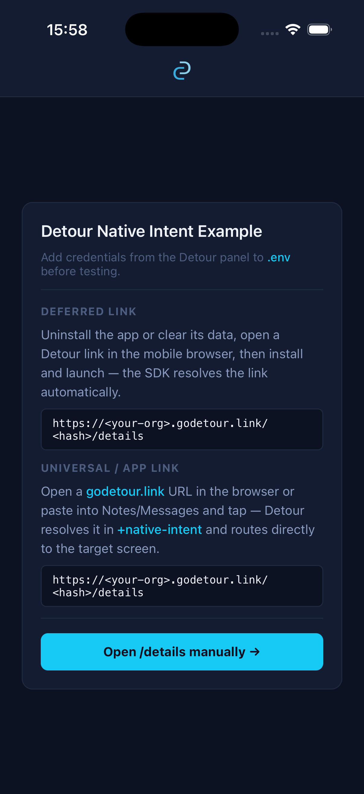
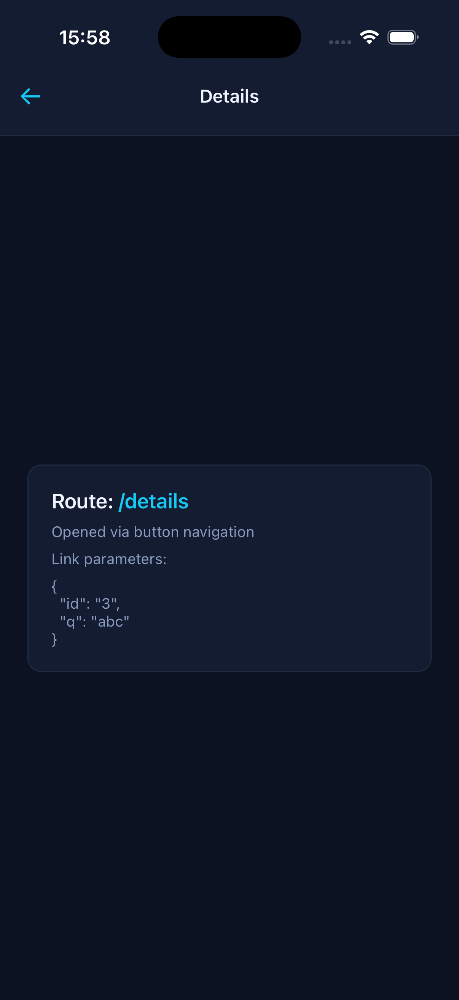
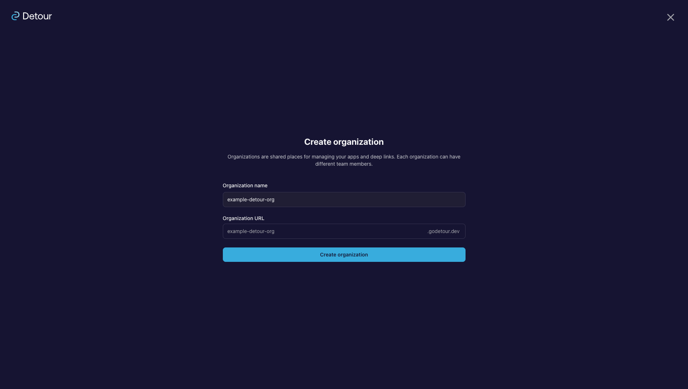
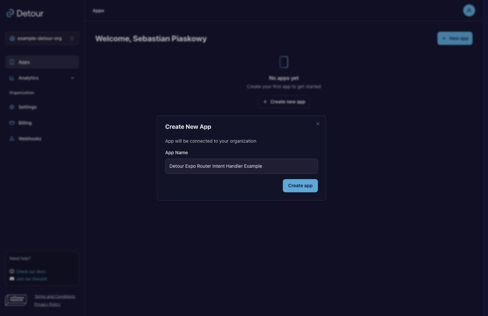
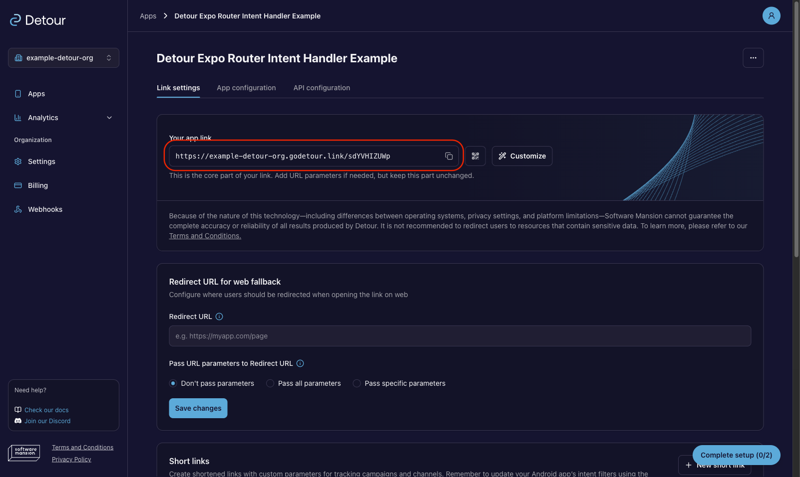
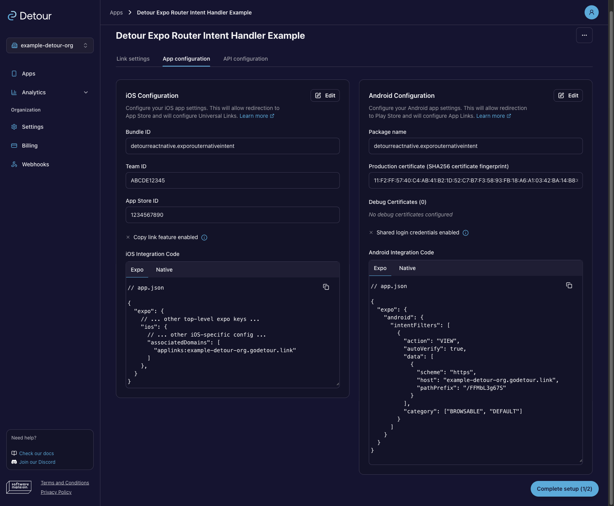
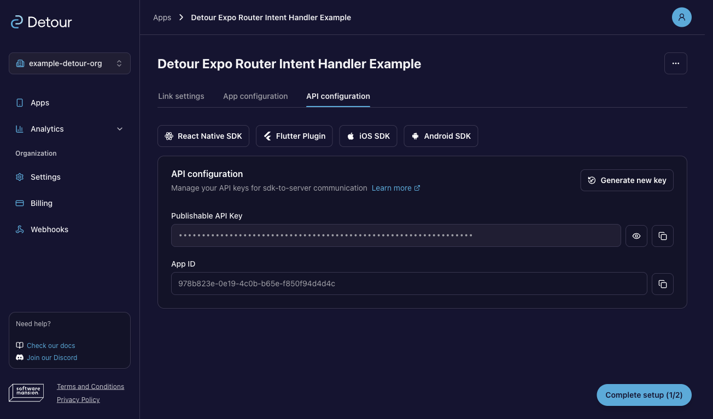

# Posted Expo Router Native Intent Example

Demonstrates the Expo Router **native-intent API** from [`@posted-sdk/react-native/expo-router`](https://postedapp.com/docs/sdk/react-native/sdk-usage) <!-- TODO(B6): update when new docs URL is live -->. Unlike the [minimal Expo Router example](../expo-router), this app resolves Posted links inside `+native-intent.tsx`, so Expo Router receives the final route directly — without the temporary fallback-route jump.

This app uses `createPostedNativeIntentHandler` in **resolve mode**:

- handler resolves Posted short links, and maps them to Expo Router paths via `mapToRoute`.
- with `linkProcessingMode: 'deferred-only'` enabled in Posted config, native-intent handles runtime links and `PostedProvider` only processes deferred ones.

Expo Router receives the final route directly, without a fallback-route jump. For the full handler API and configuration options, see the [Expo Router helper reference](https://postedapp.com/docs/sdk/react-native/api-reference#expo-router-helper). <!-- TODO(B6): update when new docs URL is live -->

**Related examples:**

- [`examples/expo-router`](../expo-router) — minimal Expo Router integration
- [`examples/expo-router-advanced`](../expo-router-advanced) — auth-gated routing flow

## Test flow

1. Start the app — you land on `/`.
2. Trigger a Posted link (see [Triggering links](#triggering-links)) — native intent resolves and maps it, routing directly to `/details` without a fallback-route jump.
3. Return to `/` — the same link should **not** trigger again.

To test the **deferred** case: follow the [Deferred deep link](#triggering-links) setup before installing. `PostedProvider` resolves it on cold start and navigates directly to the target screen.

A **custom-scheme** link (`posted-expo-router-native-intent://details`) is routed the same way by native intent — see [Triggering links](#triggering-links).

<div style="display: flex; gap: 10px; margin-bottom: 10px">
  
  
</div>

> _**App flow**. Initial screen and the `/details` screen reached via native-intent resolution, with the resolved path and any forwarded params visible (Universal link flow)._

## Set up Posted

You need a Posted account to register this app and generate its credentials. [Sign up](https://postedapp.com) <!-- TODO(B3): update once backend domain confirmed --> and open the [Posted Dashboard](https://postedapp.com) <!-- TODO(B3): update once backend domain confirmed -->. If you run into issues during setup, the [Dashboard Walkthrough](https://postedapp.com/docs/Fundamentals/dashboard) <!-- TODO(B6): update when new docs URL is live --> covers each step in detail.

### 1. Register the app

Create an organization and add a new app. Posted assigns it a base link URL of the form `https://<your-org>.l.postedapp.com/<your-app-hash>` visible in **Link settings** section.

> In **Link settings**, the dashboard asks for a fallback Redirect URL to mark setup as complete. It only controls where **web** traffic lands — it has no effect on the deferred or Universal/App link flows these examples test, so it can be left empty or filled with a placeholder URL for local development. For production, see [Full app configuration](https://postedapp.com/docs/Fundamentals/getting-started#4-complete-app-configuration). <!-- TODO(B6): update when new docs URL is live -->

→ [Dashboard › Apps](https://postedapp.com/docs/Fundamentals/dashboard#apps) <!-- TODO(B6): update when new docs URL is live -->

<div style="display: flex; gap: 10px; margin-bottom: 10px">
  
  
</div>

<br>

> **Dashboard**. _Create an organization (top-left), create a new app (top-right), and use the generated link (marked with red) in Link settings (bottom)._

### 2. Configure the platforms

Open **App configuration** and fill in the platform details:

- **iOS:** set Bundle ID to `com.postedapp.exporouternativeintent` and provide Team ID and App Store ID. The **Team ID must be your real Apple Developer Team ID** — the one the build is signed with (`DEVELOPMENT_TEAM` in Xcode › Signing & Capabilities, also shown under [Apple Developer › Membership](https://developer.apple.com/account)). A placeholder or mismatched Team ID makes the Universal link open in Safari instead of the app. The App Store ID can stay a placeholder for local development.
- **Android:** set package name to `com.postedapp.exporouternativeintent` and add a SHA-256 certificate fingerprint. The **fingerprint must match the keystore that signs the build** — a wrong value makes Android open the App link in the browser instead of the app. For local development (`npx expo run:android`), use the **local debug keystore** fingerprint. See [Testing Android App Links](https://postedapp.com/docs/sdk/react-native/testing#testing-android-app-links) <!-- TODO(B6): update when new docs URL is live --> for more info.

The dashboard generates the `associatedDomains` and intent-filter snippets to paste into `app.json` ([below](#configuring-appjson)).

> For a production integration, fill all fields with real values. See [App configuration](https://postedapp.com/docs/Fundamentals/getting-started#app-configuration) <!-- TODO(B6): update when new docs URL is live --> for full guidance.

→ [Dashboard › App configuration](https://postedapp.com/docs/Fundamentals/dashboard#app-configuration) <!-- TODO(B6): update when new docs URL is live -->


<br>

> **Dashboard › App configuration**. _iOS and Android filled configurations with generated integration code snippets ready to copy._

### 3. Copy your credentials

Open **API configuration** and copy your `appID` and publishable `apiKey` into this example's `.env` — these are the values `+native-intent.tsx` passes to `createPostedNativeIntentHandler`.

→ [Dashboard › API configuration](https://postedapp.com/docs/Fundamentals/dashboard#api-configuration-and-key-security) <!-- TODO(B6): update when new docs URL is live -->


<br>

> **Dashboard › API configuration**. _The API configuration panel with `appID` and the publishable `apiKey` ready to copy._

## Configuring app.json

Replace the placeholders in `app.json` with the values from the dashboard's [App configuration](https://postedapp.com/docs/Fundamentals/dashboard#app-configuration) <!-- TODO(B6): update when new docs URL is live --> section:

- `<your-org>` — your organization slug
- `<your-app-hash>` — the path prefix assigned to your app

```json
"ios": {
  // ...
  "associatedDomains": ["applinks:<your-org>.l.postedapp.com"]
},
"android": {
  // ...
  "intentFilters": [{
    // ...
    "data": [{ "scheme": "https", "host": "<your-org>.l.postedapp.com", "pathPrefix": "/<your-app-hash>" }]
  }]
}
```

> **Universal Links not opening the app?** Add `?mode=developer` to the `associatedDomains` entry: `"applinks:<your-org>.l.postedapp.com?mode=developer"`. This bypasses Apple's CDN and fetches the AASA file directly from your domain on every launch instead of relying on a potentially stale cached version. Requires **Settings → Developer → Associated Domains Development** to be enabled on the device and a development-signed build. Remove it before submitting to TestFlight or the App Store.

These same values go into the simulator commands in the next section.

## Triggering links

<details>
<summary>Deferred deep link</summary>

Follow these steps to test the deferred flow:

1. Uninstall the app or clear its data to start from a clean state.
2. Open a Posted link in the device's mobile browser.
3. Install and launch the app — the SDK resolves the link automatically.

> **Note:** On Android, the install referrer is typically unavailable in development builds, so deferred matching falls back to probabilistic signals (IP, device fingerprint) only. See [Limitations & Known Issues](https://postedapp.com/docs/Architecture/architecture-limitations). <!-- TODO(B6): update when new docs URL is live -->

Alternatively on iOS, you can also copy the link to your clipboard before uninstalling — the SDK reads the clipboard on first launch (`shouldUseClipboard: true`), so you can skip the browser step. It simulates a link clicked before the app was installed.

</details>

<details>
<summary>Universal / App link</summary>

Open a Posted link directly from the terminal:

```sh
# iOS simulator
xcrun simctl openurl booted "https://<your-org>.l.postedapp.com/<your-app-hash>/details"

# Android emulator
adb shell am start -a android.intent.action.VIEW -d "https://<your-org>.l.postedapp.com/<your-app-hash>/details"
```

Alternatively, paste the link into Notes or Messages on the device and tap it — this uses the same OS routing path a real user would.

</details>

<details>
<summary>Custom scheme</summary>

```sh
# iOS simulator
npx uri-scheme open "posted-expo-router-native-intent://details" --ios

# Android emulator
npx uri-scheme open "posted-expo-router-native-intent://details" --android
```

</details>

For more cases and gotchas, see [Testing & Troubleshooting](https://postedapp.com/docs/sdk/react-native/testing). <!-- TODO(B6): update when new docs URL is live -->

## Quick start

- Install dependencies from the repo root: `pnpm install`
- Configure this app in the [Posted Dashboard](https://postedapp.com) <!-- TODO(B3): update once backend domain confirmed --> using identifiers from `app.json` (for example `ios.bundleIdentifier`, `android.package`).
- Use the values from the dashboard's [API configuration](https://postedapp.com/docs/Fundamentals/dashboard#api-configuration-and-key-security) <!-- TODO(B6): update when new docs URL is live --> section to fill `.env` and update `app.json` with the generated integration code.
- Run prebuild for this example: `pnpm prebuild`
- Start the example: `pnpm start`
- Run on device/simulator: `pnpm ios` or `pnpm android`

## See also

- [SDK Usage](https://postedapp.com/docs/sdk/react-native/sdk-usage) <!-- TODO(B6): update when new docs URL is live --> — how to integrate Posted with your navigation library
- [Click Handling & Redirect Flow](https://postedapp.com/docs/Fundamentals/dashboard#links-behavior-runtime-flow) <!-- TODO(B6): update when new docs URL is live --> — how Posted resolves a link at runtime
- [API Reference](https://postedapp.com/docs/sdk/react-native/api-reference) <!-- TODO(B6): update when new docs URL is live --> — full type and method reference
- [`examples/expo-router`](../expo-router) — minimal Expo Router integration
- [`examples/expo-router-advanced`](../expo-router-advanced) — auth-gated routing flow
